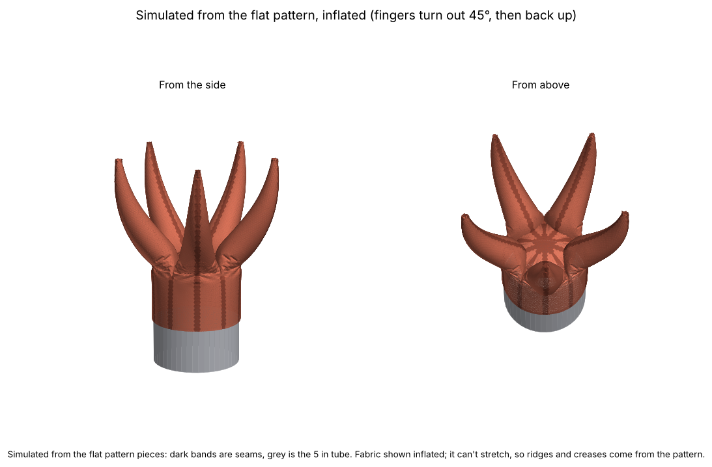
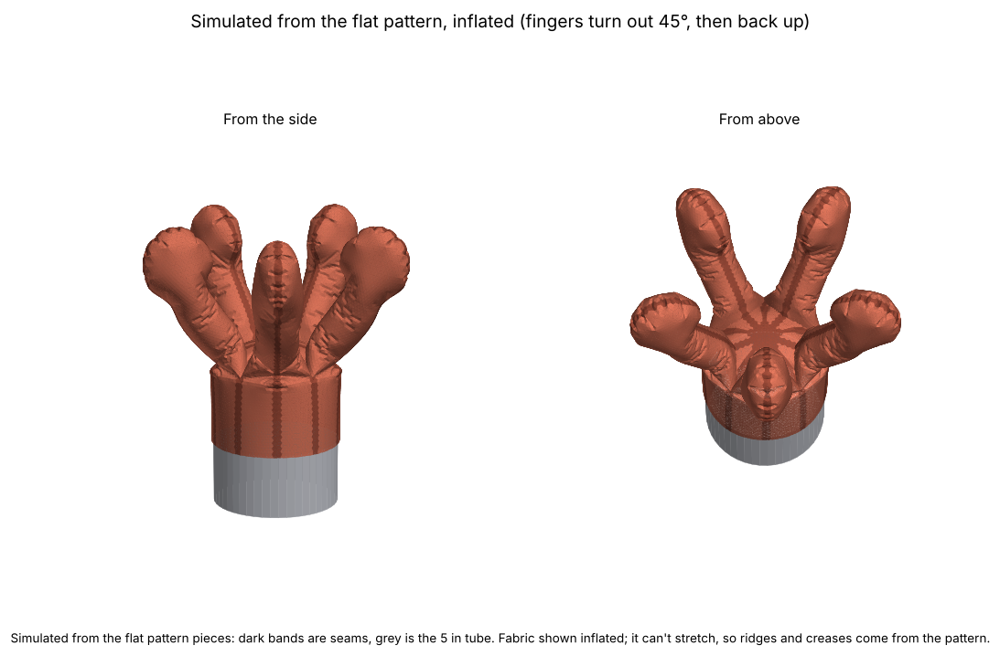

# Coral polyp sewing pattern

A fabric coral polyp made of **five fingers** around a round "wrist" (cuff) that slides over the end of a **5 in tube**. It works like an **inflatable costume**: air pressure fills it out.

Each finger is two mirror-image halves, so the seam runs from the centre of the top, out over the fingertip, and down the cuff. There's one pattern piece, and you cut 10 of it (5 pairs). The fingers **lean outward just above the cuff, then curve back up to vertical** at the tips. By default each finger starts at full width and tapers to a sharp point.

**Default design: `polyp-5-taper-tabs`** (since 2026-11-02). The `polyp-5-taper` shape, plus short string tabs along each finger's inner seam.

| Tapered point (`polyp-5-taper`, default) | Club tip (`polyp-5-club`) |
|---|---|
|  |  |

## Designs

Every file is in `designs/`, and its name starts with the design name, so a pattern and its pictures always match:
- `<design>-pattern.pdf`: the pattern to print
- `<design>-3d.png`: the simulated, inflated polyp
- `<design>-piece.png`: a quick picture of the flat piece

| Design | What it is | How to make it |
|---|---|---|
| `polyp-5-club` | 5 fingers, 7.5 in long. Each finger narrows to a skinnier middle, and the rounded end is as wide as `polyp-5-wide`'s. | `POLYP="TAPER=0,FINGER_LENGTH=7.5" python3 make_pattern.py --out designs --name polyp-5-club` |
| `polyp-5-taper-tabs` | **Default.** `polyp-5-taper` with a few string tabs on each finger's inner seam (see "The string tabs" below). Same shape and same inflated 3D picture. Only the cut line and the markings differ. | `python3 make_pattern.py --out designs` |
| `polyp-5-taper-string` | `polyp-5-taper` with one wider allowance along the whole inner seam, as a continuous tunnel (the first version of the string guide). | `POLYP="TUNNEL=2" python3 make_pattern.py --out designs` |
| `polyp-5-taper` | 5 fingers, 8.5 in long. Each finger starts at the full crotch width, like the earlier versions, and tapers all the way to a **sharp point**, like a horn. No string guides. | `POLYP="TUNNEL=0" python3 make_pattern.py --out designs` |
| `polyp-5-club-pointed` | Like the club, but 8.5 in long, with a rounded point on the end. | `POLYP="FINGER_LENGTH=8.5,TIP_LENGTH=2.8,TIP_POINT=1" ...` (made with an earlier version of the script) |
| `polyp-5-wide` | 5 fingers at an even width, 6 in long. | earlier version of the script |
| `polyp-6` | 6 fingers, 6 in long, lean out and curve back up. | earlier version of the script |
| `polyp-6-outward-4in` | 6 fingers, 4 in long, straight at the base and curving outward. | commit `e02c3d8` |

Patterns longer than one page are split over 2 landscape pages. Trim the later page on its dashed tape line, lay it over the earlier page so the lines and diamonds match, and tape. Print at **100 % / "Actual size"** and check the 1 in test square.

## Run it on your Mac (one-time setup, then just a link)

Paste this one line into the Terminal app once. It copies the project to `~/coral-simulator`, sets up Python and the libraries (a few minutes), and makes the simulator start by itself whenever you log in:

    ([ -d ~/coral-simulator ] || git clone https://github.com/RemyOP-LTL/Inflatable-Coral.git ~/coral-simulator) && cd ~/coral-simulator && git fetch origin && git checkout claude/polyp-string-fingers && git pull && bash polyps/fabric-pattern/install-mac.sh

(If macOS asks to install developer tools, accept, wait for it to finish, and paste the line again.)

After that, the simulator is always at **http://127.0.0.1:8800/**. Bookmark it. When Claude says it has pushed changes, open it, pick the branch Claude names in the Version box, and press **Get latest changes**. It updates itself and restarts. To remove it: `bash ~/coral-simulator/polyps/fabric-pattern/install-mac.sh --remove`.

## The polyp tool (easiest way to try sizes)

`polyp_tool.py` is a small page that opens in your web browser. You change numbers and see the result. You don't edit any code.

**Without the setup above (Mac):** double-click `Run Polyp Tool.command`. The first time, right-click it, choose Open, then Open again (macOS asks about files from the internet). It sets itself up in a private folder (`.venv`, a few minutes, once) and then opens the tool. Needs Python 3, which macOS offers to install if it is missing. Tested on Linux only, not yet on a Mac.

**By typing:** `python3 polyp_tool.py` (needs numpy, scipy, matplotlib and shapely installed).

- Fields: cuff diameter, cuff ease, cuff length, finger length, number of fingers, finger fullness, lean out, turn length, tab length, tabs per finger and pocket width, plus hitch depth and fabric softness for the string pull.
- The flat pattern redraws about a second after you change a number, with a link to the printable PDF.
- **Simulate inflated** (about 30 s) shows the sewn polyp with air in it.
- **Simulate string pull** (about 2 min) pulls the cords from one hitch point (see "What the string pull does" below).
- Results are saved in `tool-output/` (not kept in git). Press Ctrl+C in the terminal to stop it.
- It only runs on your own computer. It runs `make_pattern.py` and `sim_pull.py` for you, so the results match them.

## Scripts

- **make_pattern.py**: draws the pattern. The settings are at the top. Options:
  - `--out folder` sets where the files go.
  - `--name design` sets the start of every file name.
  - `--no-sim` skips the 3D simulation.
  - To override settings without editing the file, put them in `POLYP`, for example `POLYP="FINGERS=6,FINGER_LENGTH=8"`.
- **sim_polyp.py**: the cloth simulation behind the `-3d.png` pictures.
- **sim_pull.py**: the string-pull simulation. `python3 sim_pull.py --out designs` makes `<design>-pull.png` and `<design>-pull.csv`. Options: `--hitch 1.0` (inches below the centre point), `--pull-max 10`, `--steps 10`, `--soft 0.05` (fabric floppiness, 1 = stiff).
- **polyp_tool.py**: the browser page above.
- **snapshot.html**: a page showing the latest outputs of the default design. Open it in a browser here, or Claude publishes it as a link.

The scripts need `numpy`, `scipy`, `matplotlib` and `shapely` (`pip3 install numpy scipy matplotlib shapely`).

## Sizes and settings

| Setting | Value | Meaning |
|---|---|---|
| `TUBE_DIAMETER` | 5.0 in | the tube (15.71 in around) |
| `EASE` | 0.5 in | extra room in the cuff so it slides on (woven fabric). Use about -0.5 for stretchy fabric. |
| `FINGERS` | 5 | number of fingers |
| `CUFF_HEIGHT` | 3.0 in | finished height of the wrist |
| `FINGER_LENGTH` | 8.5 in | finger length on the flat piece, from crotch to tip |
| `BODY_WIDTH` | 2.6 in | flat width of the finger's middle (about 1.65 in across sewn) |
| `TIP_WIDTH` | 3.59 in | flat width of the rounded end (about 2.3 in across sewn), the same as the earlier 5-finger version |
| `TIP_LENGTH` | 2.06 in | length of the rounded end |
| `TIP_POINT` | 0.5 | end shape: 0.5 is round, 1.0 is pointed |
| `TAPER` | 1 | 1 (default) = ignore the three width settings above. The finger starts at full crotch width and tapers to a sharp point. |
| `TAPER_FULLNESS` | 0.6 | with `TAPER`: 0 gives straight cone sides, and higher values give a fuller shape before the point |
| `SPLAY` | 45° | how far the fingers lean out just above the crotch |
| `TURN_LENGTH` | 1.5 in | the distance over which they turn outward. Above that, they curve back to vertical. |
| `SEAM` | 3/8 in | seam allowance, already added to every edge |
| `HEM` | 1.0 in | extra at the bottom of the cuff for the hem |
| `TUNNEL` | 1 | string guides on the inner seam: 1 = a few short tabs (default), 2 = one wider allowance along the whole seam (`polyp-5-taper-string`), 0 = none (`polyp-5-taper`) |
| `TAB_LENGTH` | 0.375 in | length of each tab along the seam (1/4 to 1/2 in) |
| `TAB_COUNT` | 0 | tabs per finger. 0 = automatic: about one every `TAB_SPACING` (3 in), never fewer than 3 |
| `TAB_MARGIN` | 1.0 in | nearest a tab centre gets to the fingertip and to the crotch |
| `SCALE` | 1.0 | scale model: every length above (cuff, fingers, seams, tabs, hem) is multiplied by this. 0.64 gives a polyp 64 % as big. |
| `FIT_LETTER` | 0 | 1 = pick `SCALE` automatically so the cut piece fits on **one 8.5 x 11 in page**. The sizes above are then the full-size ones. |
| `TUNNEL_WIDTH` | 0.25 in | room for the cord: from the seam to the tab stitching. The cord is about 1 mm, so this is roomy. |
| `STRING_LOOP` | 1.0 in | cord left out of the centre point for the tied loop (shown in the printout, not drawn) |

The cuff comes out 16.21 in around. At the crotch (where a finger starts), each piece is 3.24 in wide, because five fingers have to fill the cuff's circumference. With `TAPER = 1` (the default), the finger tapers from there to a point. The cut piece is about 5.0 × 13.2 in. With `TAPER = 0`, the finger narrows to `BODY_WIDTH` over the first 1.5 in and widens to `TIP_WIDTH` over the last 1.5 in before the rounded end.

## How to sew it

Sew with the right (good) sides of the fabric facing each other, on the dashed line, 3/8 in in from the edge.

- **Cut 10.** Fold the fabric in half, right sides together, and cut 5. Each cut gives a mirror-image pair: the two halves of one finger.
- **Notches** (small triangles on the edges) mark the crotch. Snip no deeper than 1/4 in.
- **Slash to the dot.** The piece has a narrow V coming in from the cuff end. The seam allowances fill the point of the V, so the cut line stops short. Cut along the solid line up to the dot, and stop right at the dot. The dot is the crotch.

1. **Make the fingers.** Pin a pair together. Sew one continuous seam: from the bottom of the cuff strip, along the outer edge, around the tip, back along the inner edge, and down the straight edge of the triangle to its point. Clip into the seam allowance around the curves. Do this 5 times.
2. **Join the fingers.** The V edges of neighbouring halves are the seams between fingers. Sew the cuff edges from the dot to the bottom edge, then the triangle edges from the dot to the point. Go around until all 5 are joined.
3. **Check the middle.** All 10 triangle points meet at the centre of the top. Hand-stitch any small hole closed.
4. **Hem.** Fold the bottom edge up 1/4 in, then up 3/4 in, and stitch.
5. **Turn it right side out** through the wrist and push the fingers out.

## Paper prototype on one 8.5 x 11 sheet

For quick prototyping, the whole pattern can be shrunk to a scale model that prints on a single sheet of letter paper (landscape). In the tool, tick **Fit on one 8.5 x 11 in page**. From the command line:

    POLYP="FIT_LETTER=1" python3 make_pattern.py --out designs

- It measures the full-size piece, then picks the scale that fits (room for the labels is included). The default design comes out at **64 %**: a 3.2 in tube, 5.4 in fingers, cut piece 3.3 x 8.4 in, seam allowance 0.24 in.
- Everything scales together (cuff, fingers, seam allowance, hem, tabs, cord loop), so it is a true scale model. The angles and shapes stay the same. You can also set `SCALE` yourself, for example `POLYP="SCALE=0.5"`.
- The files get `-letter` (or `-x0.5`) in their names, so they never overwrite the full-size design. The one made on 2026-11-07 is saved as its own iteration in `iterations/letter-prototype-2026-11-07/` (with its sizes and a README).
- The 3D and string-pull simulations scale too. `--hitch` and `--pull-max` in `sim_pull.py` stay as full-size inches and shrink with the model. Forces are for the small model (they shrink roughly with the square of the scale).
- Cut 10 copies as before (5 pairs). Print the page 5 times and also 5 mirrored (flip the paper, or flip the printout over), or fold the paper in two and cut 5.
- Print at 100 % and check the 1 in square.

## The string tabs

Decided 2026-10-30, changed from a continuous tunnel to tabs on 2026-11-02 (Remy's call: less fabric where the finger should collapse easily). One cord per finger pulls the finger in. The cord is **Dyneema cord like a shoe boa lace** (about 1 mm).

- **Where.** On the finger's inner edge (the side facing the centre), between the tip and the crotch. At least 3 tabs per finger, evenly spaced, the first and last about 1 in from the tip and the crotch. The default 8.5 in finger has 3 tabs, 0.375 in long, centred 1.0, 4.5 and 8.0 in from the tip. They are drawn in blue on the pattern. A longer finger gets more (about one every 3 in).
- **Extra fabric, at the tabs only.** At each tab the seam allowance is `TUNNEL_WIDTH + SEAM` = 5/8 in instead of 3/8 in. Every other edge keeps 3/8 in.
- **Sewing a tab.** Sew the seam as normal. Don't press the allowances to one side. At each tab, lay the two small flaps flat against each other and sew them together along the blue line, 1/4 in from the seam. That leaves a small pocket for the cord. Leave the ends open.
- **The cord.** Tie a knot in the cord and stitch over it at the fingertip so it can't pull out. It runs through the three pockets and is free in between, then comes out of the centre point and ends in a tied loop. All five loops are hitched together by the one central string that winds onto the motor spool.
- **Why tabs.** A cord running the full length of the seam acts like a stiff spine along one side, so a pulled finger curls. With the cord held only at a few tabs, it takes the straight path between them, and the finger folds in on itself.

## What the string pull does (sim_pull.py)

The five cords run from the fingertips through the tabs to the centre point, then straight down to one hitch point. The hitch starts 1 in below the centre point (inside the cuff). It is pulled down a little at a time, and the fabric settles into a new shape each time.

Assumptions: the cord can't stretch; it is held only at the tip, at each tab and at the centre point, and goes straight in between; it is just taut when the polyp is fully inflated; there is no friction at the tabs; the air pressure stays constant (the blower keeps up); the tube is open, so the top can be pulled down into it. The fabric is floppy (`--soft 0.05`). Not simulated: fingers pressing on each other (one finger is held between mirror planes), gravity, fabric thickness, and the cord drag.

Forces are in pounds-force **per 1 psi of air pressure**. Multiply by the real pressure: at 0.25 psi (about 7 inches of water), the force is a quarter of the numbers shown.

Results for the default design (1 in hitch, floppy fabric):

| Hitch pulled down | Pull force (lbf per psi) | Fingertip height above the tube end |
|---|---|---|
| 0 in | 0 | 6.7 in |
| 2 in | 1.8 | 5.5 in |
| 4 in | 2.8 | 4.0 in |
| 6 in | 13.5 | 2.8 in |
| 7 in | 14.2 | 2.0 in |
| 8 in | 9.1 | 1.2 in |

The fingers fold in on themselves and crumple toward the cuff. Past about 8.5 in the model jams (the fabric would have to stretch). The force stays low until about 5 in, then peaks near 14 lbf per psi at 6 to 7 in, as the fingers crumple into the cuff and the air has to be pushed out.

How we got here: the first version had the cord following the whole seam (a continuous tunnel) and stiffer fabric. It only curled the fingers and jammed at 6 in. Remy knew real fingers collapse into themselves, which pointed at the cord model. Holding the cord only at the tabs made the difference. Making the fabric floppier changed the shape very little. The continuous-tunnel model is still available: `POLYP="TUNNEL=2" python3 sim_pull.py --soft 1`.

## How the pattern shapes the fingers

- **Width.** The flat piece is half the finger's circumference, so a sewn finger is about (2 × flat width) / π across.
- **Curve.** A finger curves when one of its sewn edges is longer than the other. The seam runs in the same plane as the curve.
  - If the inner edge (the side facing the centre of the polyp) is longer, the finger turns outward.
  - If the outer edge is longer, it turns back in.
  - Near the crotch, the inner edge is made longer, so the finger turns out by `SPLAY` over `TURN_LENGTH`.
  - Above that, the outer edge is longer, so the finger eases back to vertical by the tip.
  - To bend the sewn finger by an angle *a*, the flat piece is bent by 2*a*/π. `bend()` in `make_pattern.py` does this along the finger, following `_bend_angle()`.
  - There's a limit. If the turn is too sharp for the finger's width, the outer edge of the flat piece folds over itself. A 45° turn over 1.5 in is safely inside that limit.

## How the 3D picture is made (sim_polyp.py)

This works from the actual pattern piece, not from a drawing of the finished shape:

It simulates **one finger** (its two halves) and copies it around the polyp. The finger's side edges are held on the planes where its neighbours would be sewn on, so it behaves as if they were there. A run takes about a minute.

1. It fills each of the flat pieces with small triangles, about 1/8 in across.
2. It stitches matching seam edges together point by point.
3. It finds the resting shape by minimising energy (scipy L-BFGS):
   - fabric can't stretch, but bunches easily
   - the inside pressure fills it out, as in an inflatable
   - the tube pushes back from inside
   - the hem stays at the bottom of the tube
   - each piece has a little stiffness of its own, and there's none across seams, so ridges and curvature breaks form at the seams

What it leaves out: gravity, fabric thickness, seam-allowance bulk, the inflation air inlet, and the fingers pushing on each other.

**Finding: the inflated fingers can sit two ways, spread out or bunched up.**
- If the simulation starts from straight fingers, it gets stuck with them bunched upright.
- If it starts from the curve the pattern intends, it settles into the spread shape shown above.
- The spread shape holds more air (151 vs 149 cubic in), so inflation favours it.
- In real life, the fingers might need a nudge or a shake while inflating to pop into place.
- To make it reliable, you could add internal ties or a stiffener at the base of each finger.
- The simulation starts from the intended curve, and the `-3d.png` pictures show that result.

**Other results (quick, coarser runs):**
- The 7.5 in fingers stand about 6.1 in tall once inflated, and the tips reach about 4.3 in out from the centre.
- `polyp-5-club-pointed`'s 8.5 in fingers stand about 6.5 in tall, and the tips reach about 4.7 in out.
- The wider end reads as a gentle club shape.
- Inflated, the pointed end comes out as a blunt, slightly crumpled point. Air pressure rounds a sharp point off.

## History

- First design: version A (outer + inner halves) and version B (left + right halves). Remy chose B, and A was removed. It's still in the git history.
- Next: B with fingers curving outward from vertical (`polyp-6-outward-4in`).
- A try at a narrow neck with a bulb near the tip was dropped at Remy's request.
- Next: fingers lean out at the base and curve back to vertical, and they're longer, 6 in (`polyp-6`).
- Remy preferred 5 fingers (`polyp-5-wide`).
- Then: 5 fingers, skinnier and longer (7.5 in), with the end kept the same size (`polyp-5-club`), plus a longer version with a rounded point (`polyp-5-club-pointed`).
- Added `polyp-5-taper`, with fingers that taper to a real point. Files are now named by design.
- `polyp-5-taper-string` adds the string tunnel along each finger's inner seam.
- `polyp_tool.py` (browser page for changing sizes) and `sim_pull.py` (string-pull simulation).
- Paper prototype: `SCALE` and `FIT_LETTER` shrink the whole pattern to one 8.5 x 11 sheet.
- `polyp-5-taper-tabs`. The continuous tunnel became a few tabs per finger, and the string-pull simulation holds the cord only at the tabs.
